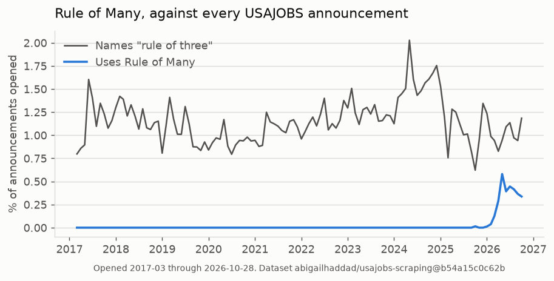
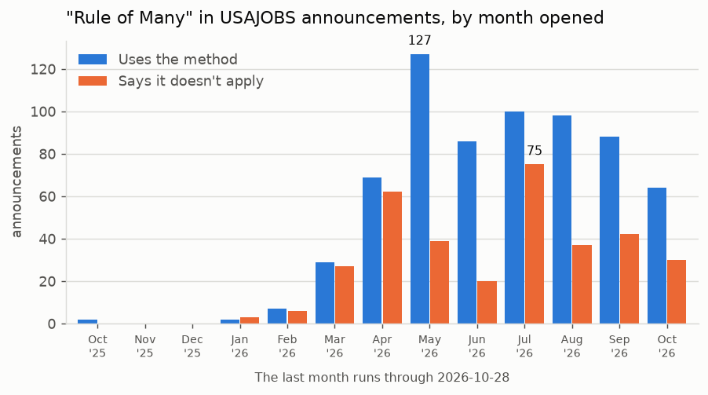
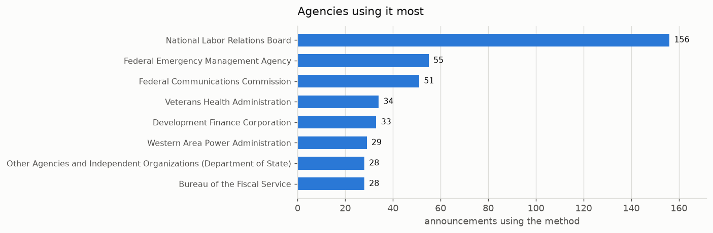

# joa

Which USAJOBS announcements use "Rule of Many" — the referral method where
everyone tied at a cut score goes to the selecting official, instead of only the
top three names.

Two things live here: a scraper that publishes announcement text to HuggingFace,
and the analysis that runs against it. Every number lives in the notebook, which
prints them from the data; the charts below are its output.

## What we found

It's new. The dataset goes back years, and nothing names the method until
recently. Then it climbs fast.



Agencies don't call it one thing. Some use "Rule of Many" as an umbrella term,
others name the specific OPM mechanism — "the Cut Score method under 5 CFR §
332.402", "Mechanism C - Set number of highest-ranked eligibles". Same
regulation, same referral. Searching only the umbrella term misses a whole set of
announcements, concentrated at a few agencies. Both families are in
`patterns.yaml`.

A lot of the announcements that print the phrase are saying it doesn't apply.
They're almost all direct-hire-authority announcements listing what they're
exempt from:

> Under the provisions of the Direct Hire Authority, Veterans Preference and the
> "Rule of Many" do not apply.

A raw phrase match counts those as adopters. Some agencies print the phrase
constantly and never use the method at all (SSA, Federal Highway, the National
Gallery of Art, Federal Transit); the notebook lists them. The two kinds of
mention don't move together month to month, so a raw count is two different
trends added up:





For scale, the method it competes with is everywhere. "Category rating" —
quality categories instead of numeric scores, under 5 USC 3319 — shows up far
more often, and announcements using it say so: "This category rating process
does not add veterans' preference points or apply the 'rule of many.'"

## Why there's a scraper

The USAJOBS API is the wrong source for announcement text, in two ways.

The Search API only lists jobs open right now, so anything that opens and closes
between collection runs is never captured. And it isn't spread evenly: some
agencies lose most of their postings this way, OPM among them.

For postings the API does return, `MatchedObjectDescriptor` drops content the
page shows. There are confirmed cases where the page says "Rule of Many" and the
API record doesn't. It hides whole agencies: Federal Highway's announcements
naming the rule are all in the API, with the phrase absent from the text of
every one.

Neither gap can be backfilled from the API afterward. The Historical API returns
metadata only, and Search returns open jobs only. usajobs.gov serves closed
announcements indefinitely, so the page is the source.

## The dataset

[`abigailhaddad/usajobs-scraping`](https://huggingface.co/datasets/abigailhaddad/usajobs-scraping) —
page text plus the structured fields from the Historical API, one parquet per
month, updated daily. It goes back years, but the earliest months hold only a
few stragglers, so the long-run chart starts at the first month with full
coverage.

The scripts here build the 2026 months:

```bash
python3 dataset.py               # posting list and metadata, from the mirror
python3 scrape.py                # every 2026 page not yet fetched
python3 publish.py --dry-run     # build/, uploading nothing
python3 publish.py               # create the repo and push, one commit
```

`scrape.py` is resumable and crash-safe. Shards are immutable part files tagged
with a per-run id, and a rerun skips every control number already stored, so you
can kill it whenever.

Daily updates run as a step inside the
[usajobs_historical](https://github.com/abigailhaddad/usajobs_historical)
pipeline, which clones this repo and runs `update_daily.py` after its own
collection. That step reads `data/historical_jobs_2026.parquet` off disk — the
copy that run just refreshed — so nothing here needs R2 credentials. On the
first of the month it passes `--refresh-all` to re-join metadata across every
month, since close dates and opening status keep changing after a posting
appears.

## The analysis

[](https://colab.research.google.com/github/abigailhaddad/joa/blob/main/rule_of_many.ipynb)

`rule_of_many.ipynb` is the readable version — the query, the two kinds of
mention side by side, the charts, and the agencies that only ever disclaim the
rule. It writes the charts above to `figures/`.

The same thing from the command line:

```bash
python3 rule_of_many.py                    # scan, classify, write results/
python3 rule_of_many.py --cached           # reclassify results/ without re-scanning
python3 rule_of_many.py --revision <sha>   # scan a specific dataset commit
```

Both go through `rule_of_many.py`. It pins one dataset commit for the whole run
(written to `results/revision.txt`), then takes the monthly files a few at a
time: download, check against the sha256 HuggingFace lists, scan, delete. Only
the per-file results are kept, in `cache/scan/`, keyed by the file's content and
the search patterns. The first run reads everything and takes a while; after
that, only files that changed are read again.

Every rule for reading a mention is in `patterns.yaml`. Edit it and run
`--cached` to reclassify off the saved contexts. Changing the `search` patterns
invalidates the cache, so the next full run re-reads every file. A posting counts as `applied` if any occurrence reads that way,
`negated` if all of them read as negations, `unclear` if no rule fires.

## Output

- `results/rule_of_many.csv` — one row per announcement, with `status`, which
  name it used, agency, series, dates, and a link
- `results/contexts.csv` — every occurrence with ±300 characters, what the
  classifier reads
- `results/hits.csv` — the raw matches before classification
- `results/monthly_counts.csv` — postings, "rule of many", "rule of three" by month
- `results/revision.txt` — the dataset commit all of the above came from
- `figures/` — the notebook's charts

## Gotchas

The phrase has to be printed. Announcements describe how they'll refer
applicants without naming the method all the time, so a zero for an agency means
it doesn't use the words.

The scraped text is the rendered page, so it carries site chrome — nav, footer,
cookie language. Anchor searches accordingly.

Whitespace is already collapsed, but soft hyphens, zero-width spaces, en dashes,
non-breaking hyphens, and unescaped entities (`&amp;`, `&#...;`) survive in the
text. Any of them inside the phrase breaks a literal match. `rule_of_many.py`
normalizes those, plus non-breaking spaces and `&nbsp;` in case they turn up,
before matching.

Agency names aren't unique. "Office of Inspector General" and "Other Agencies
and Independent Organizations" sit under several departments, so the notebook
adds the department to those.

A reposted announcement keeps its control number and gets new dates, and the
dataset can hold the old dates or both copies. The analysis keeps one row per
control number and dates it by its latest posting, from the Historical API
mirror. That's also the version the scraped page shows, so text and date agree.
The page text is as of the scrape, though, not as of the open date: an
announcement amended after it opened shows its amended wording.

A handful of announcements are agency test postings with placeholder content
("There will be duties to perform for this position").

## Layout

- `dataset.py` — the posting list, the structured fields, and compaction into
  monthly parquets. Prefers the pipeline's local mirror copy, falls back to the
  public URL.
- `scrape.py` — the scrape, and the fetch `update_daily.py` reuses
- `publish.py` — build `build/` and push it in one commit
- `update_daily.py` — the nightly top-up (named for the pipeline that calls it)
- `rule_of_many.ipynb` — the analysis, with charts
- `rule_of_many.py`, `patterns.yaml` — the scan and the classification rules
